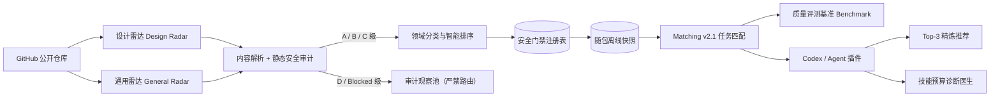

# SkillRadar

> **面向各类 AI 智能体的全门类开源技能发现、安全审计、智能排序与任务路由基础设施。**
> 涵盖软件开发、创意设计、用户运营、竞品分析、公众号写作、证券炒股与量化交易等多门类平台。

[English](README.en.md) | **中文说明** | [在线中文指南](guide.zh-CN.html) | [在线演示](https://changchangidea-oss.github.io/SkillRadar/) | [公开指标](https://changchangidea-oss.github.io/SkillRadar/metrics.html)

[](https://github.com/changchangidea-oss/SkillRadar/releases)
[](https://github.com/changchangidea-oss/SkillRadar/actions/workflows/design-radar.yml)
[](https://github.com/changchangidea-oss/SkillRadar/actions/workflows/router-benchmark.yml)
[](https://github.com/changchangidea-oss/SkillRadar/actions/workflows/security.yml)
[](LICENSE)
[](https://agentskills.io)
[](https://github.com/changchangidea-oss/SkillRadar/stargazers)


**给 SkillRadar 任何专业任务，它会返回一个精炼、通过安全门禁检查、具备明确证据支持的 Top 3 Agent Skills 集合，而不是要求你在智能体中安装成百上千个庞杂技能。**

SkillRadar 持续发现公开的 `SKILL.md` 文件，解析真实内容，执行保守的静态安全分析，按多维信号排序，内置随包分发的离线注册表，并在不自动执行任何不可信第三方代码的前提下，将任务精准路由到最契合的技能。无论是编程架构、视觉海报，还是新媒体推文、竞品拆解、财报估值与量化回测，均提供一等公民级的精准匹配。

---

## 60 秒快速上手

### 方式一：Codex 插件（推荐）

首先确保已安装 Codex CLI：

```bash
command -v codex >/dev/null 2>&1 || npm install -g @openai/codex
codex --version
```

添加插件市场并一键安装插件：

```bash
codex plugin marketplace add changchangidea-oss/SkillRadar --ref v0.5.0 && codex plugin add skillradar@skillradar
```

> 如果终端提示 `codex: command not found`，请重启终端并确保全局 npm 二进制路径已配置在 `PATH` 环境变量中。

在 Codex 交互中运行任务路由：

```text
$skill-router
为 Next.js AI 仪表盘寻找最佳技能，需集成工具调用 (tool calling) 和 shadcn/ui 组件库。
```

路由匹配将返回 Top 3 推荐，包含可审计的详细证据字段：

- `source: skillradar-registry`
- `registry.mode: local-bundled`（本地离线注册表）
- `match_score`（任务匹配得分）
- `skillradar_score`（综合质量得分）
- `security`（静态安全评级：A / B / C）
- `source`（上游代码仓库）
- `reason`（推荐理由）
- `match_details`（匹配特征证据明细）

插件采用**离线优先**与**注册表优先**机制，日常路由不依赖 Git clone 整个仓库或实时拉取 GitHub 原始内容。

### 方式二：标准 Agent Skill / skills.sh 生态

适用于兼容开放 Skills 协议的智能体（如 Claude、Cursor、Antigravity 等）：

```bash
npx skills add changchangidea-oss/SkillRadar --skill skillradar
```

标准 Skill 遵循“阅读优先、安全优先”：发现与推荐绝不意味着自动授权执行第三方代码。

### 方式三：本地启动注册表 Web UI

```bash
git clone https://github.com/changchangidea-oss/SkillRadar.git
cd SkillRadar
npm run validate
npm run benchmark:router
npm run serve
```

在浏览器打开 `http://localhost:4173` 即可体验完整的中文注册表与可视化任务路由器。

---

## 为什么需要 SkillRadar？

盲目安装数百个 Agent Skills 是错误的系统优化方向。这会导致：
1. **上下文严重拥挤**：消耗大量 LLM 上下文预算；
2. **来源与权限失控**：难以追踪代码出处与副作用；
3. **任务路由沦为盲猜**：大模型难以在庞大列表中准确选出最优组合。

SkillRadar 采用截然相反的系统原则：

- **发现要广**：全网持续采集真实优质的 Agent Skills；
- **活跃上下文要小**：按任务按需加载，绝不堆砌；
- **先审查后信任**：所有候选必须通过静态安全过滤；
- **流行度与权限分离**：GitHub Stars 绝不代表安全授权；
- **精准返回 Top 3**：针对具体任务给出最契合的精炼组合；
- **全程透明可解释**：每个推荐都有具体的信号词匹配与证据支撑；
- **诚实暴露能力缺口**：若注册表中暂无专用能力，明确提示能力缺口，绝不用无关技能滥竽充数；
- **严格量化评估**：依托 Router Quality Benchmark 基准持续保障路由质量。

---

## 核心设计与特性

### 1. 静态安全门禁 (Safety-gated discovery)
所有被发现的公开技能均需通过内容解析与静态高危能力检测。被评为 D 或 Blocked 的危险候选仅保留于审计池中，严禁进入随包发布的离线路由分片。

### 2. 特定技术证据要求 (Technology-specific evidence)
对明确提及的技术（如 Postgres, SQLite, Redis, Flutter, Next.js 等），候选技能必须具备直接的本体或任务证据支持。泛化的词汇（如 “workflow”, “integration”, “data”）不足以成为推荐专用技术的理由。

### 3. 离线优先显式路由 (Offline-first explicit routing)
Codex 插件内置了经过安全筛选的 `core + design + general` 完整注册表快照。显式路由无需联网依赖即可秒级完成。

### 4. 可审计的排序机制 (Auditable ranking)
推荐输出完整暴露相关性、SkillRadar 得分、安全评级、出处、推荐依据与信号权重，让每一次技能匹配都清晰可信。

---

## 全门类领域全景与分类体系

SkillRadar 打破单一编程局限，构建了覆盖七大维度的多门类专业智能体技能平台：

- 💻 **软件开发 (Development)**：AI 智能体 · 前端开发 · 后端与 API · 数据与数据库 · 测试与质量 · DevOps 与云服务 · 安全审计 · 移动端开发 · 自动化与集成。
- 🎨 **创意设计 (Design & Media)**：12 个专业设计雷达方向，涵盖 UI/UX 设计 · 视觉传达 · 品牌系统 · 交互体验 · 空间与建筑渲染 · 动效与影视 · 工业设计与 CAD 建模 · 3D 打印 · 数媒艺术。
- 📈 **运营与增长 (Operations & Growth)**：用户增长 · 留存转化 · 转化漏斗诊断 · 社群私域运营 · 广告投放归因与 ROI 优化 · 活动裂变。
- 🔍 **竞品分析与商研 (Competitive Analysis)**：竞品深度拆解 · 功能差异矩阵 · SWOT 态势分析 · 商业模式画布对比 · 市场规模测算 (TAM/SAM/SOM) · 行业研报提炼。
- ✍️ **公众号写作与内容创作 (Content & Copywriting)**：微信公众号爆款推文创作 · 爆款标题策划 · 推文结构排版 · 新媒体文案润色与降重 · 小红书种草文案 · 品牌营销故事。
- 📊 **证券炒股与投研 (Stock & Equity)**：上市公司财报深度穿透分析 · DCF 现金流估值建模 · 基本面投研报告 · K 线形态识别 · 技术指标 (MACD/KDJ) 研判 · 资金流向与筹码分布。
- ⚡ **量化交易与金融工程 (Quantitative Trading)**：CTA 动量与趋势策略 · 自适应网格交易 · 多因子 Alpha 选股模型 · 历史策略回测 · 最大回撤控制与夏普比率绩效归因 · 统计套利与算法交易。

---

## 匹配算法 Matching v2.1

超越简单的子串匹配，v2.1 具备：
- **概念与短语识别**：理解 App Router、tool calling、设计系统、多因子量化、商业模式画布等复合概念；
- **全门类双语分面映射**：内置 `ZH_FACETS`，原生理解“公众号排版”、“竞品拆解”、“财报估值”、“量化回测”、“用户增长投放”、“Redis 缓存”等全门类中文任务描述；
- **防止短 token 误触**：避免诸如 “ai” 错误匹配 “tailwind” 的问题；
- **字段加权体系**：本体 (Identity)、标签 (Tags)、领域 (Domains)、摘要 (Summary)、仓库出处 (Source) 分级赋权；
- **任务覆盖率衡量**：度量候选对显式任务需求的覆盖比例；
- **先验因子加分**：融合代码质量、静态安全性与维护新鲜度；
- **互补重排 (Complementary Reranking)**：Top 3 候选相互补充，分别覆盖任务的不同侧面；
- **安全降级提示**：若排第一的技能评级为 C，且存在评分相近的 A/B 候选，系统将主动出具更安全的替代建议。

---

## 质量基准评测 (Router Benchmark)

项目包含可度量的黄金基准测试集，杜绝凭主观感觉调整算法。

最新基准表现：
- **7 / 7** 黄金路由用例全部通过；
- 通过率：**100%**；
- Top-3 中危险 (D/Blocked) 结果数量：**0**；
- 平均 Top-1 匹配度得分：**84.4**；
- 项目上下文隔离与显式任务主导测试：**全部通过**。

基准定义文件位于 `data/router-benchmark.json`，最新运行结果记录于 `data/router-benchmark-latest.json`。

---

## 技能上下文医生 (Skill Budget Doctor)

针对 Codex 及大模型的有限可见元数据预算，过多技能会导致严重的上下文消耗。通过 `$manage-skills` 命令可调用制度化的只读诊断器：

- 盘点用户、项目及已启用插件的全部技能；
- 估算目录上下文占用比例；
- 识别相似或重复的技能组并推荐最佳保留项；
- 生成只读的精简建议（如 `[[skills.config]] ... enabled = false` 片段）；
- **绝不**在未经用户明确批准的情况下直接修改配置文件或执行任何卸载操作。

---

## 架构示意图



---

## 安全边界与审计等级

> **重要原则：发现 ≠ 授权执行 (Discovery is not execution)**

静态分析器重点审查高危指令与潜在副作用，包括破坏性 shell 命令、管道下载执行、动态代码运行、机密密钥访问、外网请求、包安装、文件系统写入及部署工具等。

安全等级说明：
- **A 级** — 低风险静态特征，无明显副作用。
- **B 级** — 具备有限副作用或包含常规开发脚本，使用前需留意。
- **C 级** — 涉及敏感操作，推荐与安装前需人工明确审查代码。
- **D 级** — 仅供安全审计参考，绝不进入自动路由推荐。
- **Blocked** — 明确包含恶意或严重高危模式，全流程拦截。

*注：本评级体系为启发式保守静态分析，不可替代专业安全审计。*

---

## 插件命令清单 (Codex Plugin)

插件源码位于 `packages/codex-plugin/`：
- `$skill-router <任务描述>` — 根据任务输出具备证据支撑的 Top 3 技能组合；
- `$find-skill <关键词>` — 检索核心、通用与设计技能注册表；
- `$inspect-skill <技能名称>` — 审查指定技能的来源出处、质量指标与安全详情；
- `$manage-skills` — 诊断当前环境的技能预算、上下文压力与重复项清理建议。

---

## 目录结构地图

```text
SkillRadar/
├── .agents/plugins/marketplace.json       # Codex 插件市场定义
├── .github/workflows/                     # CI 与每日雷达工作流
├── skills/skillradar/SKILL.md             # 标准 Agent Skill 声明
├── index.html                             # 本地与线上注册表 Web UI（中文版）
├── metrics.html                           # 公开运营与采纳指标看板（中文版）
├── guide.zh-CN.html                       # 中文用户与体验指南
├── assets/
│   ├── app.js                             # Web UI 交互与渲染
│   ├── web-router.js                      # 浏览器端 Matching v2.1 路由算法
│   └── styles.css                         # 样式表与中文排版优化
├── data/
│   ├── skills.json                        # 核心技能基线
│   ├── general-domains.json               # 通用领域分类定义
│   ├── general-skills-radar.json          # 通用技能路由分片
│   ├── router-benchmark.json              # 路由器黄金评测基准用例
│   └── router-benchmark-latest.json       # 最新基准验证报告
├── packages/codex-plugin/                 # Codex 插件完整包
│   ├── data/registry.json                 # 随插件打包的离线安全注册表
│   ├── scripts/skillradar.mjs             # 插件核心路由器脚本
│   └── skills/                            # 插件提供的 4 大内置命令
└── scripts/                               # 校验、基准与自动化构建脚本
```

---

## 开源公开页面

- 官方注册表：[https://changchangidea-oss.github.io/SkillRadar/](https://changchangidea-oss.github.io/SkillRadar/)
- 指标看板：[https://changchangidea-oss.github.io/SkillRadar/metrics.html](https://changchangidea-oss.github.io/SkillRadar/metrics.html)
- 中文说明指南：[https://changchangidea-oss.github.io/SkillRadar/guide.zh-CN.html](https://changchangidea-oss.github.io/SkillRadar/guide.zh-CN.html)

---

## 参与贡献

欢迎提交新的公开 Agent Skills 来源、安全规则、领域分类建议或任务路由反馈！
详见 [CONTRIBUTING.md](CONTRIBUTING.md) 与 [docs/ADOPTION.md](docs/ADOPTION.md)。

---

## 开源协议

本项目采用 [MIT 许可证](LICENSE)。
